# ☁️ CloudCart — Cloud-Native Application, CI/CD & Observability

<p align="center">
  <strong>A cloud-native e-commerce demo built with Flask, Docker, Kubernetes, GitHub Actions, Docker Hub, Slack, Prometheus and Grafana.</strong>
</p>

<p align="center">
  
  
  
  
  
  
  
</p>

CloudCart is a learning and portfolio project demonstrating how to containerise a web application, automate image publishing, deploy it to Kubernetes, configure horizontal pod autoscaling, and observe application and cluster metrics.

## 📌 Project Overview

CloudCart is a responsive e-commerce demonstration application with product browsing, search, filtering, sorting, a shopping cart and a demo checkout flow. It is supported by an automated delivery pipeline and a local Kubernetes monitoring environment.

**Key objectives**
- Build and containerise a Python Flask web application.
- Automate Docker image builds and publishing with GitHub Actions.
- Store container images in Docker Hub.
- Send CI/CD status notifications to Slack.
- Deploy and expose the application on Kubernetes.
- Configure CPU-based Horizontal Pod Autoscaling (HPA).
- Monitor resource utilisation with Prometheus and Grafana.

## 🏗️ Architecture

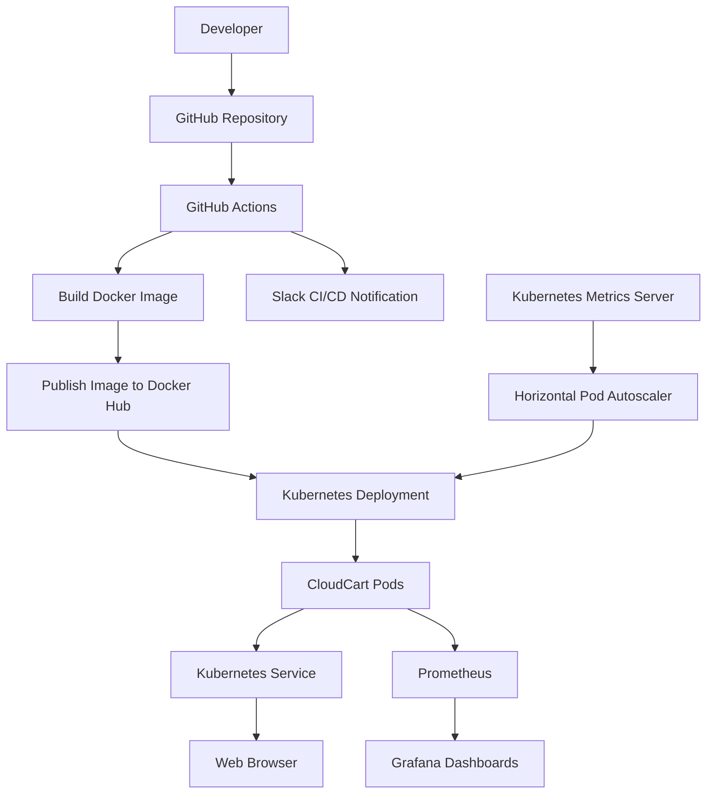

> **Deployment environment:** Kubernetes runs locally through Docker Desktop/Kind. This project demonstrates Kubernetes deployment and autoscaling without requiring a paid managed Kubernetes cluster.

## 🔄 CI/CD Workflow

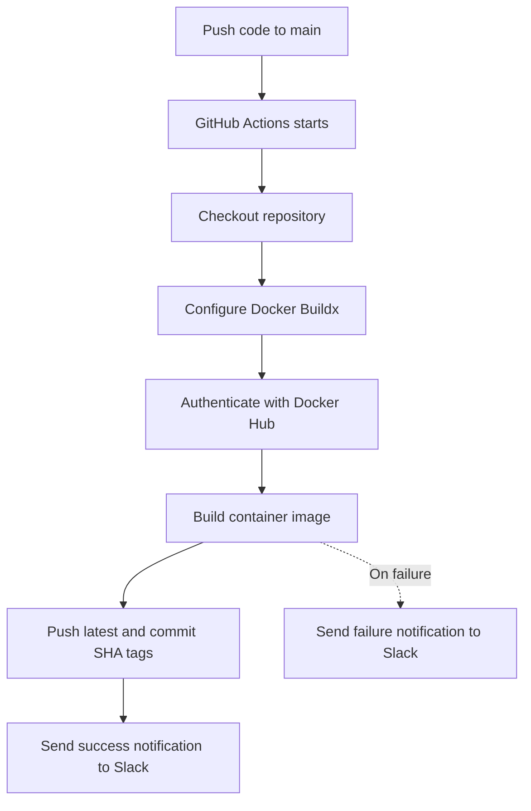

### Pipeline responsibilities

1. A developer pushes changes to the `main` branch.
2. GitHub Actions checks out the repository.
3. Docker Buildx builds the application image.
4. GitHub Actions authenticates with Docker Hub using repository secrets.
5. The image is published with `latest` and commit-SHA tags.
6. Slack receives a success or failure notification.

## 🛍️ Application Preview

The following screenshots are stored in the repository's `screenshots/` directory.

### CloudCart running in the browser

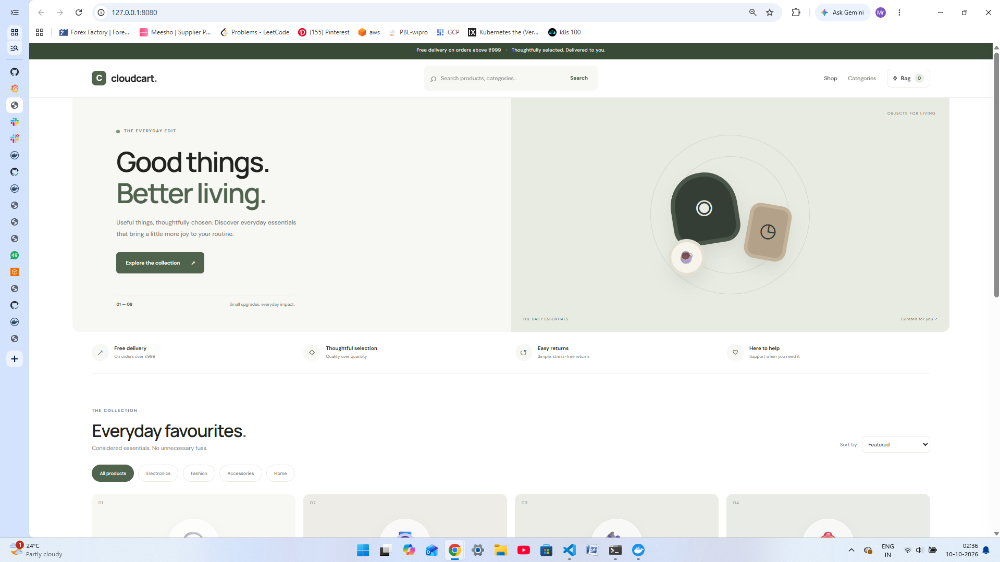

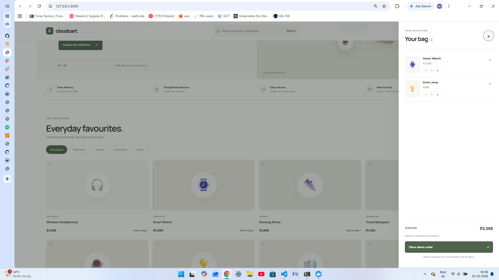

## 🐳 Docker Containerisation

CloudCart is packaged into a Docker image using a Dockerfile and Gunicorn as the production-style WSGI server.

### Docker container

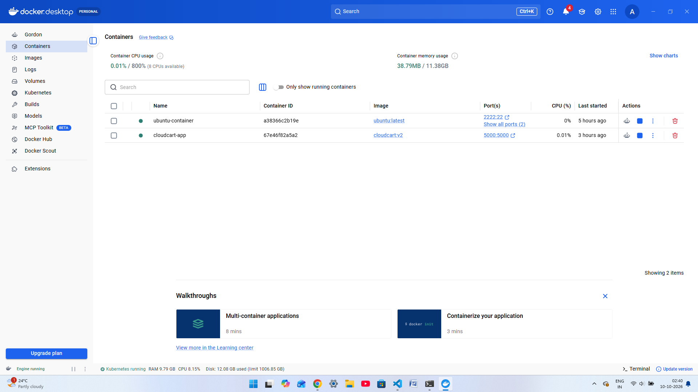

### Docker images

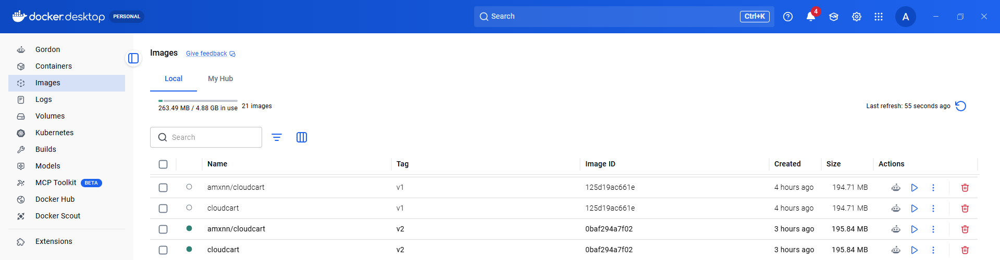

### Docker Hub repository

**Published image:** [`amxnn/cloudcart`](https://hub.docker.com/r/amxnn/cloudcart)

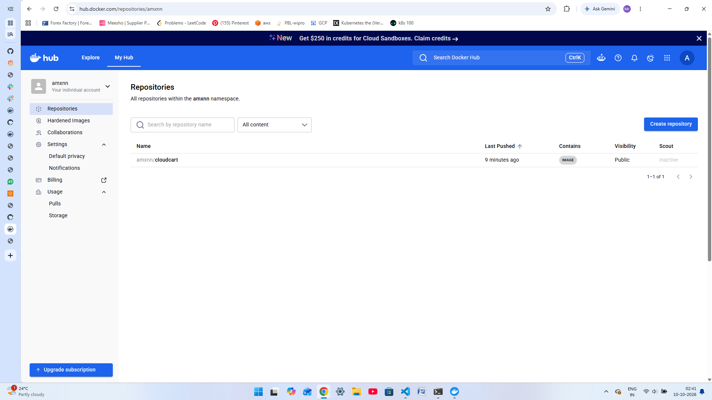

Pull and run the image:

```bash
docker pull amxnn/cloudcart:latest
docker run --rm -p 5000:5000 amxnn/cloudcart:latest
```

Open `http://localhost:5000` in your browser.

Health endpoint:

```bash
curl http://localhost:5000/health
```

Expected response:

```json
{
  "status": "healthy",
  "application": "CloudCart"
}
```

## ⚙️ GitHub Actions CI/CD

The pipeline configuration is available at:

`.github/workflows/docker-publish.yml`

### Workflow file

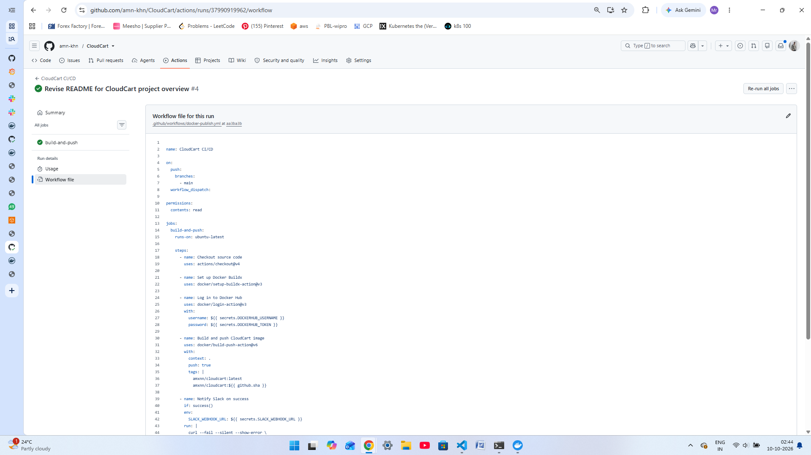

### CI/CD execution

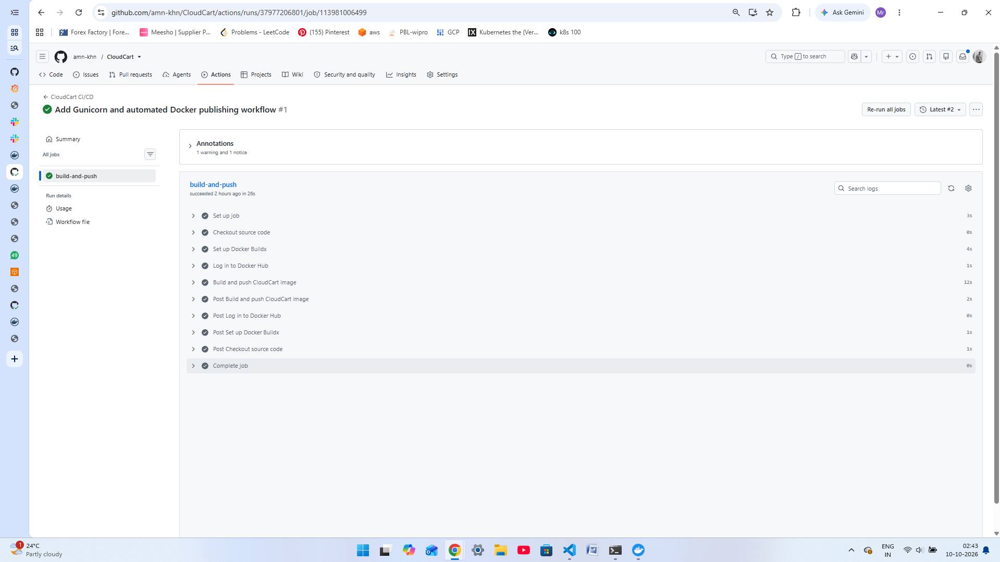

The workflow uses GitHub Actions secrets rather than hard-coded credentials:

- `DOCKERHUB_USERNAME`
- `DOCKERHUB_TOKEN`
- `SLACK_WEBHOOK_URL`

**Security note:** Never commit Docker Hub tokens, Slack webhook URLs, passwords or other secrets to the repository.

## 🔔 Slack Notifications

Slack integration provides pipeline status updates to the configured CloudCart CI/CD channel.

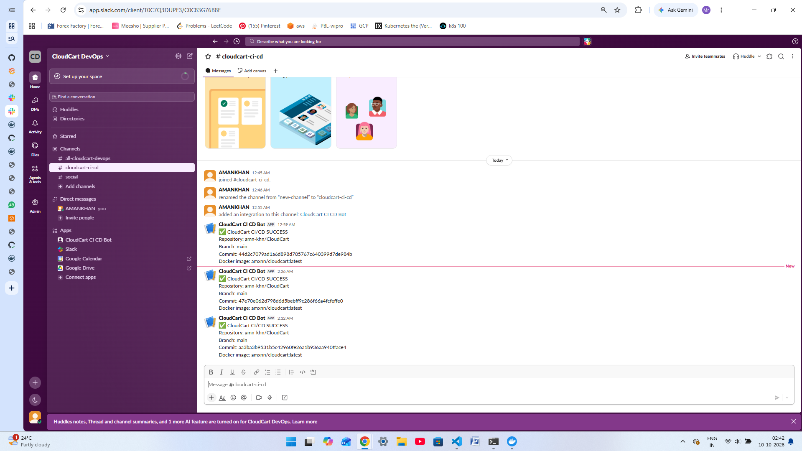

Notifications include the repository, branch, commit and Docker image details.

## ☸️ Kubernetes Deployment

CloudCart is deployed on a local Kubernetes cluster. The application runs in a Deployment and is exposed through a Kubernetes Service.

### Kubernetes resources

| Resource | Purpose |
|---|---|
| Deployment | Manages application replicas and rolling updates |
| Pod | Runs a CloudCart application container |
| Service | Provides stable access to application Pods |
| Metrics Server | Supplies resource metrics for Kubernetes autoscaling |
| Horizontal Pod Autoscaler | Adjusts replica count based on CPU utilisation |

### Example Kubernetes commands

```bash
kubectl get nodes
kubectl get deployments
kubectl get pods
kubectl get services
kubectl get hpa
```

Forward the application to your local machine:

```bash
kubectl port-forward deployment/cloudcart 8081:5000
```

Then open `http://127.0.0.1:8081`.

If the chosen local port is already occupied, use another available port.

## 📈 Horizontal Pod Autoscaling (HPA)

The Horizontal Pod Autoscaler adjusts the number of application Pods in response to CPU utilisation.

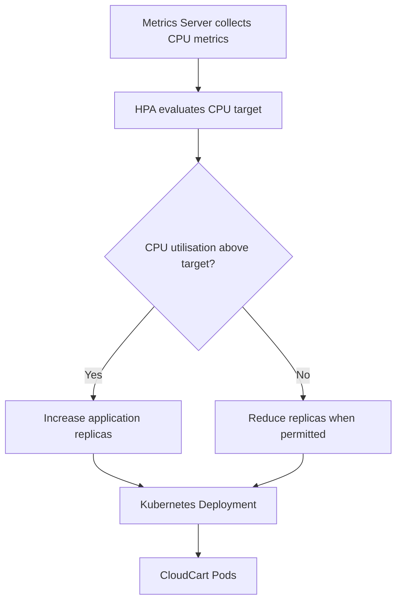

The configured HPA targets **50% average CPU utilisation**, with a minimum of **1 replica** and a maximum of **5 replicas**.

Check the current scaling status:

```bash
kubectl get hpa cloudcart
kubectl describe hpa cloudcart
kubectl get deployment cloudcart
kubectl top pods
```

The scaling test demonstrated scale-out under generated load and scale-in after the load generator was removed.

## 📊 Monitoring with Prometheus and Grafana

Prometheus collects metrics, while Grafana visualises resource utilisation and cluster performance.

### Grafana cluster dashboard

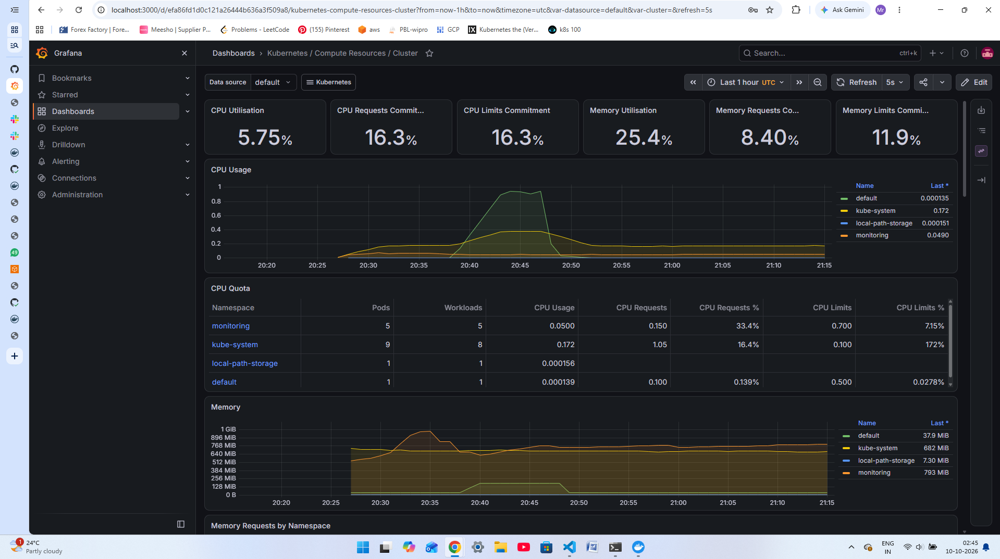

### Additional Grafana metrics view

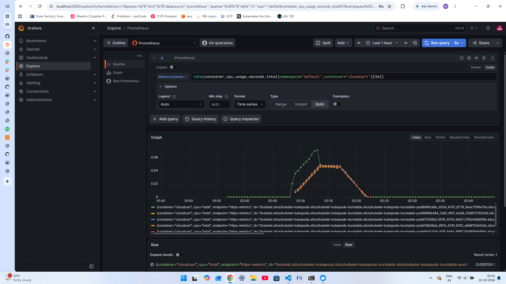

### Useful Prometheus queries

**CloudCart CPU usage**

```promql
rate(container_cpu_usage_seconds_total{namespace="default",container="cloudcart"}[5m])
```

**CloudCart memory usage**

```promql
container_memory_working_set_bytes{namespace="default",container="cloudcart"}
```

These queries can be used in Grafana Explore to inspect the application's CPU and memory metrics.

## 🧪 Application API

| Endpoint | Method | Purpose |
|---|---|---|
| `/` | GET | Displays the CloudCart storefront |
| `/health` | GET | Returns application health status |
| `/api/products` | GET | Returns the product catalogue |
| `/api/orders` | POST | Validates a demo order and returns its total |

The checkout endpoint is for demonstration only. It does not process real payments or provide persistent order storage.

## 🧰 Technology Stack

| Category | Technologies |
|---|---|
| Application | Python, Flask, HTML, CSS, JavaScript |
| Web server | Gunicorn |
| Containerisation | Docker |
| Container registry | Docker Hub |
| CI/CD | GitHub Actions |
| Notifications | Slack Incoming Webhook |
| Orchestration | Kubernetes, Docker Desktop/Kind |
| Autoscaling metrics | Kubernetes Metrics Server, HPA |
| Monitoring | Prometheus, Grafana |
| Version control | Git, GitHub |

## 🚀 Run Locally

### 1. Clone the repository

```bash
git clone https://github.com/amn-khn/CloudCart.git
cd CloudCart
```

### 2. Create a virtual environment

```bash
python -m venv .venv
```

Activate it on Windows PowerShell:

```powershell
.\.venv\Scripts\Activate.ps1
```

### 3. Install dependencies

```bash
pip install -r requirements.txt
```

### 4. Start the application

```bash
python -m flask --app app run --debug
```

Open `http://127.0.0.1:5000`.

For containerised execution, use the Docker commands in the Docker section.

## 📁 Repository Structure

```text
CloudCart/
├── .github/
│   └── workflows/
│       └── docker-publish.yml
├── screenshots/
│   ├── cicd.png
│   ├── docker-container.png
│   ├── docker-images.png
│   ├── dockerhub-repo.png
│   ├── grafana-1.png
│   ├── grafana-2.png
│   ├── output-1.png
│   ├── output-2.png
│   ├── slack-notification.png
│   └── workflow-file.png
├── static/
│   ├── app.js
│   └── style.css
├── templates/
│   └── index.html
├── .gitignore
├── Dockerfile
├── LICENSE
├── README.md
├── app.py
└── requirements.txt
```

## 🔐 Security and Limitations

- Credentials and webhook URLs are stored in GitHub Actions secrets.
- The local demonstration configuration should not be treated as a production security baseline.
- The demo checkout does not integrate with a payment provider.
- The project does not implement persistent order storage.
- The monitoring stack is intended for learning and local demonstration; production deployments require appropriate authentication, TLS, resource planning and secret management.

## 🎯 Learning Outcomes

- Containerised a Flask application with Docker.
- Published container images to Docker Hub.
- Automated image publishing using GitHub Actions.
- Integrated Slack notifications into a CI/CD pipeline.
- Deployed a containerised application on Kubernetes.
- Configured CPU-based horizontal autoscaling and validated scale-out/scale-in.
- Explored application and cluster metrics through Prometheus and Grafana.

## 🔮 Future Enhancements

- Deploy to a managed Kubernetes service such as Amazon EKS.
- Add automated unit and integration tests to the CI/CD pipeline.
- Add persistent order storage with a database.
- Introduce Kubernetes Ingress and HTTPS.
- Add alert rules and dashboards for application-specific metrics.
- Implement stronger production security and secret management.

## 👨‍💻 Author

**MOHAMMED AMANKHAN**

- GitHub: [amn-khn](https://github.com/amn-khn)
- Project repository: [CloudCart](https://github.com/amn-khn/CloudCart)
- Docker Hub: [amxnn/cloudcart](https://hub.docker.com/r/amxnn/cloudcart)
- LinkedIn: [Mohammed Amankhan](https://www.linkedin.com/in/mohammed-amankhan)

## 📄 Licence

This project is distributed under the MIT Licence. See [`LICENSE`](LICENSE) for details.
