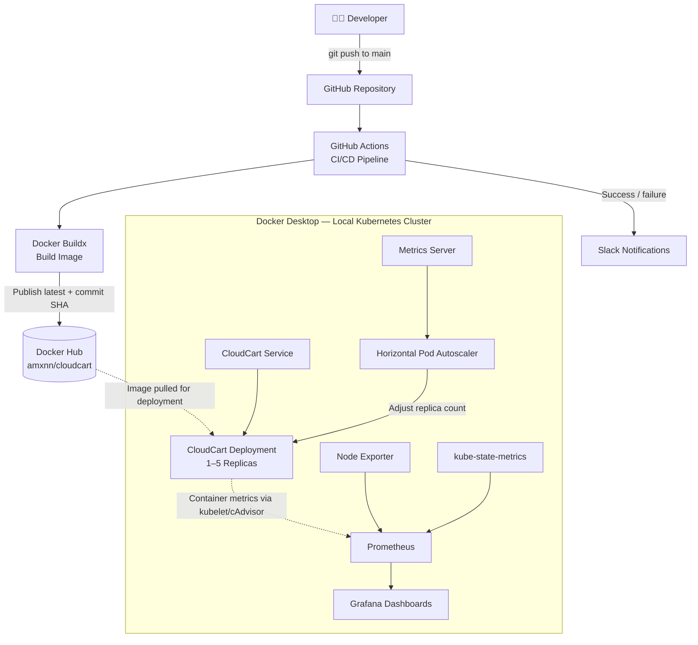
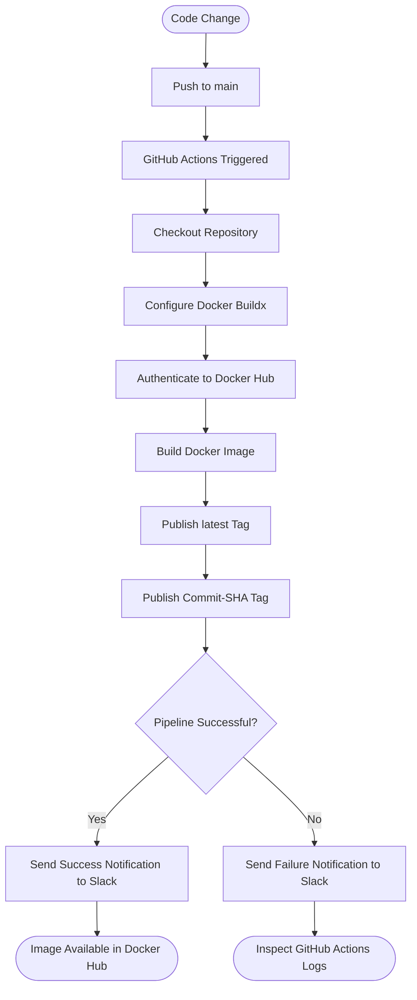
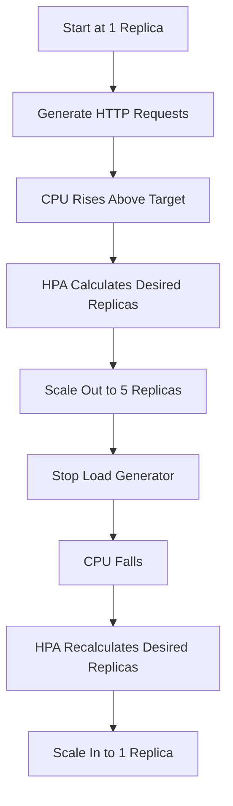

# ☁️ CloudCart — Cloud-Native DevOps Capstone

<p align="center">
  <strong>Automated CI/CD · Containerisation · Kubernetes · Autoscaling · Observability</strong>
</p>

<p align="center">
  
  
  
  
  
  
  
</p>

<p align="center">
  <strong>A practical end-to-end DevOps project demonstrating how a containerised web application is built, published, deployed, monitored and automatically scaled.</strong>
</p>

---

## 📌 Project Overview

**CloudCart** is a Flask-based e-commerce demonstration application developed to explore modern cloud-native application delivery and DevOps automation.

The project combines automated Docker image publishing, GitHub Actions, Slack notifications, Kubernetes orchestration, Horizontal Pod Autoscaling (HPA), Prometheus metrics collection and Grafana dashboards.

It demonstrates the workflow from source-code changes to a published container image, followed by deployment and operational monitoring in a local Kubernetes environment.

### 🎯 Project Objectives

- Containerise a web application using Docker.
- Automate image builds and publishing with GitHub Actions.
- Notify a Slack channel about pipeline success or failure.
- Deploy the application on Kubernetes.
- Automatically scale application replicas based on CPU utilisation.
- Monitor CPU, memory and Kubernetes resources using Prometheus and Grafana.
- Document and validate the system through practical tests.

## 🏗️ System Architecture



> **Deployment scope:** GitHub Actions automatically builds and publishes Docker images. The current Kubernetes deployment is managed separately on Docker Desktop; a fully automated Kubernetes rollout is a potential future enhancement.

## 🔄 CI/CD Workflow

The workflow is defined in `.github/workflows/docker-publish.yml`.



### Pipeline Responsibilities

| Stage | Implementation |
|---|---|
| Source control | Git and GitHub |
| Trigger | Push to `main` or manual workflow dispatch |
| Image build | Docker Buildx |
| Image registry | Docker Hub |
| Image tags | `latest` and Git commit SHA |
| Notifications | Slack incoming webhook |
| Workflow definition | `.github/workflows/docker-publish.yml` |

### 🔐 GitHub Actions Secrets

Configure the following in **GitHub → Settings → Secrets and variables → Actions**.

| Secret | Purpose |
|---|---|
| `DOCKERHUB_USERNAME` | Docker Hub username |
| `DOCKERHUB_TOKEN` | Docker Hub access token |
| `SLACK_WEBHOOK_URL` | Slack incoming webhook |

Never commit tokens, webhook URLs or passwords to Git.

## 🛍️ Application Features

CloudCart provides a simple storefront with:

- Product listings and product search.
- Filtering and sorting.
- Shopping cart interface.
- Demo checkout flow.
- REST API endpoints.
- Health-check endpoint for application verification.
- Responsive web interface.

### API Endpoints

| Endpoint | Method | Description |
|---|---|---|
| `/` | `GET` | Displays the storefront |
| `/health` | `GET` | Returns application health status |
| `/api/products` | `GET` | Returns the product catalogue |
| `/api/orders` | `POST` | Returns a demo order response |

**Note:** This is a demonstration application. The checkout does not process real payments, and orders are not persistently stored.

## 🧰 Technology Stack

| Technology | Role |
|---|---|
| Python and Flask | Application backend |
| HTML, CSS and JavaScript | Frontend |
| Docker | Containerisation |
| Docker Hub | Image registry |
| Git and GitHub | Source control |
| GitHub Actions | CI/CD automation |
| Slack | Pipeline notifications |
| Kubernetes | Application orchestration |
| Metrics Server | CPU metrics for HPA |
| Prometheus | Metrics collection |
| Grafana | Dashboards and visualisation |
| Helm | Monitoring stack installation |

## 🚀 Run the Application Locally

### Prerequisites

- Git
- Docker Desktop
- A terminal such as PowerShell

### 1. Clone the repository

```bash
git clone https://github.com/amn-khn/CloudCart.git
cd CloudCart
```

### 2. Build the image

```bash
docker build -t cloudcart:local .
```

### 3. Run the container

```bash
docker run --name cloudcart-local -p 5000:5000 cloudcart:local
```

### 4. Access the application

- **Storefront:** http://localhost:5000
- **Health check:** http://localhost:5000/health

Stop and remove the container when finished:

```bash
docker stop cloudcart-local
docker rm cloudcart-local
```

## 🐳 Docker Hub

The published container image is available at:

**[View CloudCart on Docker Hub](https://hub.docker.com/r/amxnn/cloudcart)**

Pull and run the latest image:

```bash
docker pull amxnn/cloudcart:latest
docker run --name cloudcart-demo -p 5000:5000 amxnn/cloudcart:latest
```

The GitHub Actions workflow publishes the `latest` tag and a commit-SHA tag.

## ☸️ Kubernetes Deployment

CloudCart runs on a local Kubernetes cluster created through Docker Desktop.

### Inspect the deployment

```bash
kubectl get nodes
kubectl get deployment cloudcart
kubectl get pods
kubectl get services
```

### Inspect application resources

The deployment uses the following resource requests and limits:

| Resource | Request | Limit |
|---|---:|---:|
| CPU | 100m | 500m |
| Memory | 128Mi | 256Mi |

### Access CloudCart

The Kubernetes Service is available inside the cluster. For local access, use:

```bash
kubectl port-forward deployment/cloudcart 8080:5000
```

Open http://localhost:8080 while port forwarding is active.

## 📈 Horizontal Pod Autoscaling

CloudCart uses Kubernetes HPA to adjust the replica count based on CPU utilisation.

| Setting | Value |
|---|---:|
| Minimum replicas | 1 |
| Maximum replicas | 5 |
| Target CPU utilisation | 50% of requested CPU |
| Scale-up stabilisation window | 0 seconds |
| Scale-down stabilisation window | 60 seconds |

Inspect the autoscaler:

```bash
kubectl get hpa cloudcart
kubectl describe hpa cloudcart
kubectl get deployment cloudcart
kubectl top pods
```

### Autoscaling Test Workflow



### Test Load Generator

A temporary BusyBox pod was used to repeatedly call the CloudCart health endpoint:

```bash
kubectl run cpu-load --image=busybox:1.36 --restart=Never -- /bin/sh -c "while true; do wget -q -O- http://cloudcart:5000/health >/dev/null; done"
```

Remove the load generator after the test:

```bash
kubectl delete pod cpu-load
```

### Observed Results

The local test demonstrated:

| Test stage | Observed result |
|---|---|
| Initial state | 1 CloudCart replica |
| Under load | CPU utilisation reached approximately 230% of the requested CPU |
| Scale-out | HPA increased replicas to 5 |
| After load stopped | CPU utilisation fell to approximately 1% |
| Scale-in | HPA returned the deployment to 1 replica |

These are observed results from the local test environment, not a production performance benchmark.

## 📊 Prometheus and Grafana Observability

The monitoring stack was installed using the `kube-prometheus-stack` Helm chart in the `monitoring` namespace.

### Check monitoring components

```bash
kubectl get pods -n monitoring
kubectl get services -n monitoring
```

### Access Grafana

```bash
kubectl port-forward -n monitoring service/monitoring-grafana 3000:80
```

Open http://localhost:3000.

Use the local demo credentials configured for your installation. Do not publish passwords or Kubernetes secrets.

### Metrics Verified

- Kubernetes cluster CPU utilisation.
- Kubernetes memory utilisation.
- Namespace resource usage.
- CloudCart container CPU usage.
- CloudCart container memory usage.

### Example PromQL Queries

**CloudCart CPU usage**

```promql
rate(container_cpu_usage_seconds_total{namespace="default",container="cloudcart"}[5m])
```

**CloudCart memory usage**

```promql
container_memory_working_set_bytes{namespace="default",container="cloudcart"}
```

The project was verified with working CPU and memory graphs in Grafana.

## 🧪 Validation and Testing

The following checks were performed during development:

- [x] Application health endpoint tested.
- [x] Docker image built and run locally.
- [x] Image published to Docker Hub.
- [x] GitHub Actions workflow completed successfully.
- [x] Slack pipeline notification received.
- [x] CloudCart deployed to Kubernetes.
- [x] Metrics Server resource metrics verified.
- [x] Prometheus and Grafana installed.
- [x] CloudCart CPU and memory metrics visualised.
- [x] HPA scale-out from 1 to 5 replicas verified.
- [x] HPA scale-in from 5 to 1 replica verified.

## 🔒 Security and Limitations

- The application is a demo storefront, not a production commerce platform.
- The deployment runs on local Docker Desktop Kubernetes rather than AWS EKS.
- The CI/CD pipeline publishes images but does not automatically roll out changes to Kubernetes.
- The local Metrics Server configuration uses insecure kubelet TLS verification to work around local certificate issues. This is not suitable for production.
- Demo credentials must be changed and secured before any public deployment.
- No claim is made that the application has undergone a production security audit or comprehensive performance benchmark.

## 🚧 Future Enhancements

- Deploy CloudCart to AWS EKS.
- Use AWS ECR for image storage.
- Automate Kubernetes rollout after image publishing.
- Add unit and integration tests to CI/CD.
- Add persistent storage for orders.
- Implement production-grade secret management and HTTPS.
- Add application-level metrics, alerts and service-level indicators.
- Introduce ingress and production deployment practices.

## 📚 Project Resources

| Resource | Link |
|---|---|
| GitHub Repository | [amn-khn/CloudCart](https://github.com/amn-khn/CloudCart) |
| Docker Hub Image | [amxnn/cloudcart](https://hub.docker.com/r/amxnn/cloudcart) |

## 👨‍💻 Conclusion

CloudCart demonstrates a practical DevOps workflow combining containerisation, automated image publishing, Kubernetes orchestration, horizontal autoscaling and observability.

The project provides hands-on experience with tools used in Cloud and DevOps engineering and establishes a foundation for future deployment to a managed cloud environment.

---

<p align="center">
  <strong>CloudCart · Learn by building. Improve by automating.</strong>
</p>
MIT License

Copyright (c) 2026 MOHAMMED AMANKHAN

Permission is hereby granted, free of charge, to any person obtaining a copy
of this software and associated documentation files (the "Software"), to deal
in the Software without restriction, including without limitation the rights
to use, copy, modify, merge, publish, distribute, sublicense, and/or sell
copies of the Software, and to permit persons to whom the Software is
furnished to do so, subject to the following conditions:

The above copyright notice and this permission notice shall be included in all
copies or substantial portions of the Software.

THE SOFTWARE IS PROVIDED "AS IS", WITHOUT WARRANTY OF ANY KIND, EXPRESS OR
IMPLIED, INCLUDING BUT NOT LIMITED TO THE WARRANTIES OF MERCHANTABILITY,
FITNESS FOR A PARTICULAR PURPOSE AND NONINFRINGEMENT. IN NO EVENT SHALL THE
AUTHORS OR COPYRIGHT HOLDERS BE LIABLE FOR ANY CLAIM, DAMAGES OR OTHER
LIABILITY, WHETHER IN AN ACTION OF CONTRACT, TORT OR OTHERWISE, ARISING FROM,
OUT OF OR IN CONNECTION WITH THE SOFTWARE OR THE USE OR OTHER DEALINGS IN THE
SOFTWARE.
